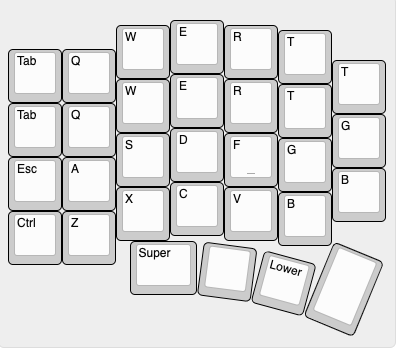

# Sage60

60% の分割キーボード。左右とも nRF52840（MX 版は XIAO nRF52840）で、左右間・PC とは BLE で無線接続する。右手の親指側にトラックボール（PMW3610）。
スイッチは MX / Kailh Choc v2（同じ PCB）と、東プレ（静電容量）版がある。

**[ギャラリーサイト](https://diwamoto.github.io/sage60/)**: 3D モデルと構造の解説（`case/site/`）

## ディレクトリ

| パス | 中身 |
| --- | --- |
| `pcb/mx/`, `pcb/ec/` | KiCad の基板・回路図（`pcb/README.md`） |
| `case/` | ケースを KiCad から作るスクリプト（Python + Fusion）。ガスケットマウント、磁石固定、MX とロープロファイル（`case/README.md`） |
| `case/trackball/` | トラックボールケースの改造スクリプトと取得手順（ケース本体は fork） |
| `firmware/zmk/` | ZMK の設定（shield `sage60` = MX、`sage60_ec` = 東プレ）。`build.sh` でローカルビルド、GitHub Actions でもビルド |
| `production/` | 発注・印刷に使う出力物 |
| `docs/` | 配列（`kle.json`）、配線図（`sage60_wiring.drawio`）、画像 |

`production/` の中身:

| パス | 用途 |
| --- | --- |
| `case_cnc/` | ケース上下の STEP（JLCCNC） |
| `case_print/` | ケース上下・MCU カバー・シムの 3MF / STL（3D プリント） |
| `plate/` | プレートの DXF（外形の元データ。ケース生成もここから読む）/ STEP（金属）、3MF（プリント） |
| `mcu_cover/` | MCU カバーの DXF（ウォルナット） |

## ファームウェア

ZMK。東プレ版は nRF52840 の ADC で静電容量を読んでキー入力を判定する（判定方法は[こちら](https://nogikes.booth.pm/items/2373281)、[こちら](https://booth.pm/ja/items/2232932)を参考）。

## ライセンス

MIT（`LICENSE`）。PMW3610 センサー基板とトラックボールケースは GPL-3.0 なので [Diwamoto/roBa の `sage60` ブランチ](https://github.com/Diwamoto/roBa/tree/sage60) に分けている。

## 参考
* zmk の設定: [tako-config](https://github.com/ssbb/tako-config)
* 基板: [tako](https://github.com/ssbb/tako)
* センサー基板・トラックボールケース: [roBa](https://github.com/kumamuk-git/roBa)（ケースの元は Keyball Trackball Case by kepeo）
